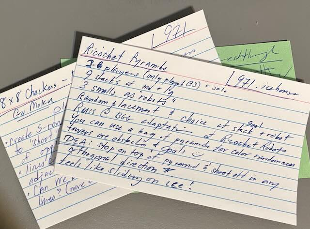
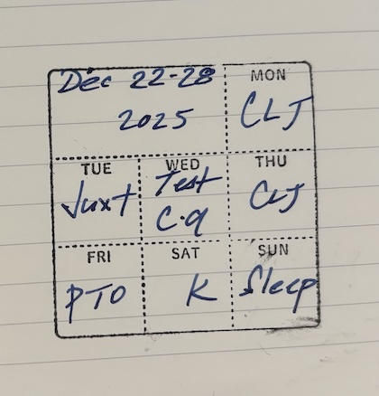
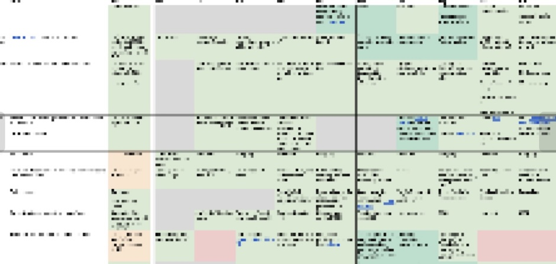
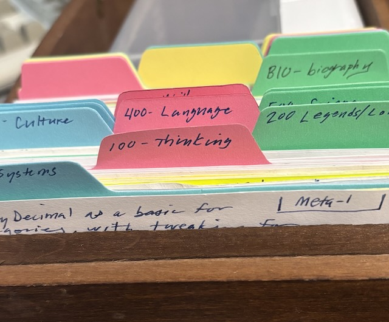
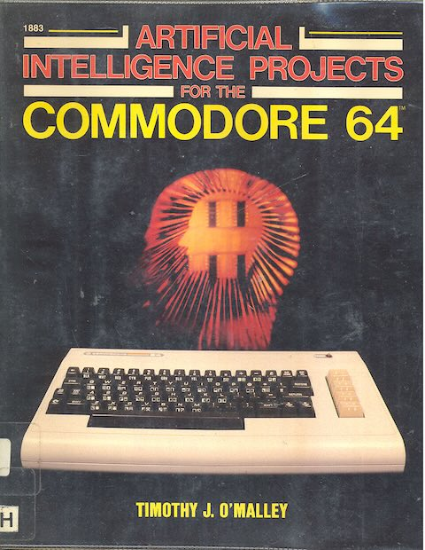

Great things and people that I discovered, learned, read, met, etc. in 2025.  No particular ordering is implied.  Not everything is new.

*also: see the lists from [2024](https://blog.fogus.me/2024/12/23/the-best-things-and-stuff-of-2024.html), [2023](https://blog.fogus.me/2023/12/18/the-best-things-and-stuff-of-2023/), [2022](http://blog.fogus.me/2022/12/13/the-best-things-and-stuff-of-2022/), [2021](https://blog.fogus.me/2021/12/27/the-best-things-and-stuff-of-2021/), [2020](http://blog.fogus.me/2020/12/31/the-best-things-and-stuff-of-2020/), [2019](http://blog.fogus.me/2019/12/30/the-best-things-and-stuff-of-2019/), [2018](http://blog.fogus.me/2019/01/02/the-best-things-and-stuff-of-2018/), [2017](http://blog.fogus.me/2018/01/02/the-best-things-and-stuff-of-2017/), [2016](http://blog.fogus.me/2016/12/29/the-best-things-and-stuff-of-2016/), [2015](http://blog.fogus.me/2015/12/29/the-best-things-and-stuff-of-2015/), [2014](http://blog.fogus.me/2014/12/29/the-best-things-and-stuff-of-2014/), [2013](http://blog.fogus.me/2013/12/27/the-best-things-and-stuff-of-2013/), [2012](http://blog.fogus.me/2012/12/26/the-best-things-and-stuff-of-2012/), [2011](http://blog.fogus.me/2011/12/31/the-best-things-and-stuff-of-2011/) and [2010](http://blog.fogus.me/2010/12/30/the-best-things-in-2010/)*

## Great posts | articles | vids read/watched

* *[A calculator app? Anyone could make that](https://chadnauseam.com/coding/random/calculator-app)* by Chad Nauseam, esquire - *I love the story about how Hans Boehm and friends developed a mind-blowing approach called recursive real arithmetic for numbers like pi and (sqrt 2). The post details various symptom -> problem definition -> alternative solutions -> solution cycles that the team met along the way and should be required reading for programmers.*
* *[Lost in Manboo](https://www.youtube.com/watch?v=JVyz17kwIv4)* - *マンガ喫茶マンボ (manga cafe manboo) shows life for some folks who live in 24-hour game cafes in Japan. The video is dystopic in a way that matches our modern world perfectly.*[^afterdark]
* *[The Making of Deeper in You on the OP-1](https://www.youtube.com/watch?v=0z7_A_8il_g)* - *Shows an artist's approach to song creation/composition using the OP-1 synthesizer. This is hypnotic to watch for someone with zero musical talent like myself.*
* *[An interview with Jack Rusher](https://thecreativeindependent.com/people/multi-disciplinary-artist-jack-rusher-on-the-need-to-sustain-your-creative-drive-in-the-face-of-technological-change/)* by The Creative Independent - *A lovely interview with online friend Jack Rusher discussing the thoughtful application of tech in art, flow, and the state of research in the modern computing industry.*
* *[Uncredited: Searching for Lost Board Game Designers](https://www.youtube.com/watch?v=MWteJW-wYas)* by Amabel Holland - *Amabel describes her trials and tribulations while trying to find the designers of the long-forgotten board game [Duplicate Ad-Lib Crossword Cubes](https://boardgamegeek.com/boardgame/4791/duplicate-ad-lib-crossword-cubes).*
* *[Brian Weissman on his Magic the Gathering history](https://www.youtube.com/watch?v=TldMsMtHvW8)* - *For anyone who came of age during the earliest years of Magic, the name Brian Weissman is legendary. In this interview he gives countless anecdotes about his experiences in those early days.*
* *[Before Arcturus: David Lindsay's Lost Novels](https://wormwoodiana.blogspot.com/2025/08/before-arcturus-david-lindsays-lost.html)* by Mark Valentine - *Mark's research into David Lindsay revealed evidence that he submitted at least two earlier novels, Aletheus and The Confessions of an Egoist, to the publisher Chatto & Windus in 1902 and 1908. These submissions predated his first published masterpiece, [A Voyage to Arcturus](https://bookshop.org/p/books/a-voyage-to-arcturus-an-illuminated-edition-david-lindsay/76f8dc45a1376ddf?aid=98208&ean=9781948886307&listref=best-things-2025&next=t).*
* *[What Dan Read](https://what-dan-read.com/)* by Dan - *An amazing account of a lifetime of reading.*
* *[Two Years After Cormac McCarthy’s Death, Rare Access to His Personal Library Reveals the Man Behind the Myth](https://www.smithsonianmag.com/arts-culture/two-years-cormac-mccarthys-death-rare-access-to-personal-library-reveals-man-behind-myth-180987150/)* by Richard Grant - *A glimpse into Cormac McCarthy's massive, chaotically organized personal library reveals the reclusive author as a polymath with an insatiable curiosity. Scholars are currently cataloging the estimated 20,000 volumes, many of which contain the author's annotations.*

[^afterdark]: The video has similar vibes to Haruki Murakami's excellent book After Dark.

## Most viewed posts/videos with/by me

While I've posted a few technical post on my personal blog, I've taken a lot of time to guest-post on the [Wormwoodania blog](https://wormwoodiana.blogspot.com/search/label/Fogus) about weird, macabre, and sardonic fiction and other related, non-technical topics. I hope to continue this trend into next year. Also, my most assiduous readers will have noticed that I've written more about games. I've decided to keep those posts on this blog since my intent for the site has always been about systems and systems-thinking and games are a great way to study and model systems.

* *[The long season of langdev](https://blog.fogus.me/langdev/long-season.html)* - *Whereby I speculate if programming language development is in a lull.*
* *[On 'Baron Corvo: The Greatest Asshole Who Ever Lived'](https://wormwoodiana.blogspot.com/2025/08/on-baron-corvo-greatest-asshole-who.html)* - *My review of Johan Kugelberg's pamphlet on why Baron Corvo still intrigues people.*[^cath]
* *[Derek Raymond and 'The Black Novel'](https://wormwoodiana.blogspot.com/2025/09/derek-raymond-and-black-novel-guest.html)* - *Discusses the author Derek Raymond's criteria for what he calls 'black novels'.*
* *[Corvo's Icicle](https://wormwoodiana.blogspot.com/2025/06/corvos-icicle-guest-post-by-fogus.html)* - *Did Baron Corvo invent the mystery trope of the melting weapon?*
* *[Arities as Pseudo-Protocol](https://blog.fogus.me/clojure/arities-as-proto.html)* - *Whereby I describe a little-used Clojure technique leveraging function arities as a lightweight interface/protocol.*
* *[My appearance on the Apropos Podcast](https://www.youtube.com/watch?v=_g69GKN6lAM)* - *Sat down with the Apropos crew and had a great time talking Clojure.*
* *[Meeting Corvo and Weeks in Georgetown](https://wormwoodiana.blogspot.com/2025/03/meeting-corvo-and-weeks-in-georgetown.html)* - *A brief description of some of my hobby research.*
* *[18XX: A System of Systems](https://blog.fogus.me/games/18XX/intro.html)* - *A description of 18XX board games as a system of systems.*
* *[The Bird-Poker Deck](https://blog.fogus.me/games/bird-poker.html)* - *A truncated pack of playing cards that displays some interesting game-play characteristics.*
* *[Checkers Arcade](https://blog.fogus.me/games/checkers-arcade.html)* - *Using an American Checkers set to play many deep games of abstract strategy.*

[^cath]: I'd love to try and write something about Corvo's obsession with the Catholic hierarchy and the tenuous idea that it was a kind of occult architecture. This may be a bridge too far for my ability and knowledge.

## Favorite technical books discovered (and read)

* **[Mouse, a Language for Microcomputers](http://mouse.davidgsimpson.com/)** by Peter Grogono - *Mouse is basically an esolang with barely any abstraction facilities, but the book was well-written and the language compelling enough to explore further.*
* **[Notes on Distance Dialing](https://explodingthephone.com/hoppdocs/nodd1956.pdf)** (pdf) by AT&T - *Described the telephone systems of the USA and Canada in the mid-1950s. The reading is a dry as it gets, but it was a fascinating dive into a vastly complex system solving extremely hard problems. This is a must-read for folks interested in systems-thinking. That said, I am actively looking for recommendations for books about the process of designing and building the unbelievably complex telephony system over the rudiments of the earlier systems. Recommendations welcomed!*

## Favorite non-technical books read

The vast majority of my reading this year was fiction, and I discovered some real gems.[^bsorg]

* **[The Eye of Osiris](https://www.gutenberg.org/ebooks/24201)** by R. Austin Freeman - *This is the first book that I've read from Freeman and I suspect that I will read many more in the future. The story follows the disappearance of John Bellingham, Egyptologist and the subsequent investigation. As the investigation stalls, the eminent Dr. Thorndyke digs into the case. The story sets up the mystery nicely and indeed provides enough information to the reader to infer how the disappearance occurred and who or what facilitated it. The book is one of the best whodunits that I've ever read.*
* **[The Mystery of Edwin Drood](https://www.gutenberg.org/ebooks/564)** by Charles Dickens - *His final work remains unfinished as he passed away before he could complete it. Further complicating the meta-story is that he also didn't outline the ending nor even put to paper the "villain" of the story. The meta-mystery of the ending has motivated a mountain of speculation around the ending including dozens of continuations of the story from other authors, all deriving their pet endings from textual hints, accounts from Dickens' friends, illustration notes, and even in some cases seances supposedly accompanied by the spirit of Dickens himself. What was written by Dickens is spectacular and a compelling mystery and although it would be great to know the resolution, in some ways the "Droodiana" that has cropped up over the past 150+ years is reason enough for it to remain a mystery. The whole lore around Edwin Drood is a worthwhile hobby in itself and well-worth exploring. The [Chiltern Library edition](https://www.amazon.com/dp/B0000CHQCS/?tag=fogus-20) of the book contains the story and a good bit of the lore around the writing and the meta-works available at the time of its publication.[^still]*
* **[The Shadow People](https://www.amazon.com/shadow-people-Margaret-St-Clair/dp/B00005XVNT/?tag=fogus-20)** by Margaret St. Clair - *Sadly out of print and difficult to find, but I've had it on my shelves for decades and finally got around to reading it. The book came onto my radar in the 1980s when I learned about it in the [appendix-n](https://en.wikipedia.org/wiki/Appendix_N) of the 1st edition Advanced D&D Dungeon Masters Guide. I enjoyed many of the books at the time and have slowly swung around to re-reading them over the past few years. Sadly, most on the list do not stand the test of time for me, but St. Clair's mixture of 60s counter-cultural leanings in a fantasy/sf world still works. The cultural touch-points in the book feel quite dated, but despite the occasional awkwardness, the story is unique even today.*
* **[Lolly Willowes](https://bookshop.org/p/books/lolly-willowes-warbler-classics-annotated-edition-sylvia-townsend-warner/793f95da3bb968a0?aid=98208&ean=9781959891635&listref=best-things-2025&next=t)** by Sylvia Townsend Warner - *The book started as a passable novel of manners focused on a turn of the century British middle-class family. The titular character was mostly background decoration for the first third of the novel and AFAIR was talked about only in the third-person. It's only when she made the choice to move out on her own to the country[^inabeautifuplace] in her middle age does she gain a central role in the narrative and her inner thoughts revealed. This is where things really pick up because I was shocked to learn that this unassuming woman's inner thoughts had a delicious darkness to them. I don't want to give away too much, but I'll just say that you will not expect how the story ends.*
* **[Patience](https://www.fantagraphics.com/collections/daniel-clowes/products/patience)** by Daniel Clowes - *A profound graphic novel using time-travel to explore the idea of enduring love with a story that proceed through time, following Jack as he tries to alter the past and save the woman he loves. This well-known science fiction motif is elevated by Clowes' signature psychological complexity.*
* **[Narcissus and Goldmund](https://bookshop.org/p/books/narcissus-and-goldmund-hermann-hesse/2249287049aa22fb?aid=98208&ean=9780553275865&listref=best-things-2025&next=t)** by Herman Hesse - *I've read most of the books by Hermann Hesse but this one escaped my attention until this year. The story follows the parallel lives of a monk Narcissus and his passionate friend Goldmund as they respectively search for meaning in life through spiritual means and through pleasures of the flesh.*
* **[We Who Are About To...](https://bookshop.org/p/books/we-who-are-about-to-joanna-russ/a7176b6dc2109f04?aid=98208&ean=9780819567598&listref=best-things-2025&next=t)** by Joanna Russ - *A small group of astronauts crash land on a hostile alien world and quickly realize that rescue is unlikely to come. Many SF stories have started this way and so the expectation is that this is a colonization story... but Russ thrives on subverting reader expectations.*
* **[Fifty Forgotten Records](https://tartaruspress.com/russell-fifty-forgotten-records.html)** by R.B. Russell - *Another lovely entry in Russell's series (one can hope) of autobiographical explorations of art, so far covering literature and now music. This book describes 50 records of varying popularity and Russell's personal connections to each. While I certainly enjoyed finding a dozen or so new albums to explore, the true triumph of the book lies in the vulnerable, reflective memoir threaded throughout.*
* **[The Way of All Flesh](https://bookshop.org/p/books/the-way-of-all-flesh-samuel-butler/b5c2be53f34c9706?aid=98208&ean=9780375752490&listref=best-things-2025&next=t)** by Samuel Butler *A novel that follows 4-generations of the Ponitifex family, with a particular bildungsromanesque thread around Ernest, a young man who's naivete leads to his downfall and how his life unfolds thereafter.[^bc]

[^bc]: Interestingly, this was a recommendation from friend [David Nolen](https://www.linkedin.com/in/david-nolen-37b42813/), who also mentioned another book that just barely missed this list, [Benito Cereno](https://bookshop.org/p/books/melville-s-short-novels-authoritative-texts-contexts-criticism-herman-melville/f3008086921a816b?aid=98208&ean=9780393976410&listref=best-things-2025&next=t) which I think needs another read in the future.*

[^still]: A lot more Droodiana has been written since 1950 of course.

[^bsorg]: I have some of these books listed at [bookshop.org](https://bookshop.org/lists/best-things-2025) if you're interested in grabbing copies.

[^inabeautifuplace]: The "move to the country" theme present in a significant number of pre-WWII fiction representing a reclamation of feminine power. I would love to find/create a list of books exploring this theme.

## Number of books written or published

As I mentioned, I have taken to writing more on non-technical topics, but I've even taken to dabble in fiction this year. I wrote a lot of fiction when I was (much) younger but all that I wrote from those days resides at the bottom of a landfill in Baltimore... which is probably for the best. I doubt that this avenue will result in any publications or even anything worth reading at all, but I'm having a great time regardless.

## Number of programming languages designed

I've tinkered with a concatenative functional programming language named Juxt for years, but it's not something that anyone should ever use. My thoughts are almost entirely focused exclusively on moving Clojure into the future, but I take a moment to think in stacks from time to time.[^uiua]

[^uiua]: If you're interested in exploring an interesting new programming language that mixes interesting ideas, then I recommend [Uiua](https://www.uiua.org/) that bills itself as a point-free, APL-style, array-oriented modern language.

## Favorite musicians / albums discovered

* *[lovesliescrushing](https://lovesliescrushing.bandcamp.com/)* - *It's been quite a while since I've discovered any good ambient. This duo's catalog has accompanied many of my 2025 coding activities.*
* *[Whistle And I'll Come to You](https://deathandvanillamusic.bandcamp.com/album/whistle-and-ill-come-to-you)* by Death and Vanilla - *An album that conjures the atmosphere of folk horror films despite its electronic and psychedelic tones. It has a vaguely similar ethereal beauty that drew me to Dead Can Dance 100 years ago.*
* *[Closer](https://mariachiaramusic.bandcamp.com/album/closer)* by Maria Chiara Argirò - *Her jazz-infused electronic ambient music drilled its way into my ear and nested in my brain for months.*

The artist that I listened to the most in 2025 was [Cocteau Twins](https://cocteautwins.com/) -- which probably mirrors a couple of years around when I was 15 or 16.[^castr]

[^castr]: I was in a "junk shop" a couple of weeks ago and found both Black Sabbath's *Master of Reality* and the *Complete Vatican Recordings* of the works of Alessandro Moreschi... two albums that couldn't be more different. I suspect that one of both of these albums will get a lot of play in 2026.

## Favorite show about a misanthrope tasked with saving a humanity that might not be worth saving at all

[Pluribus](https://www.imdb.com/title/tt22202452/)

## Favorite films discovered

* **[Weapons](https://www.imdb.com/title/tt26581740/)** by Zach Cregger - *This one was probably my pick for the best new horror film released in 2025. Like Cregger's other horror film [Barbarian](https://www.imdb.com/title/tt15791034/),[^barb] Weapons mixed in black humor without being ham-handed about it. The highlight of the film was the performance by Amy Madigan, who stole every scene that she was in.*
* **[Triangle of Sadness](https://www.imdb.com/title/tt7322224/)** by Ruben Östlund - *Östlund is truly the master of the cringey moment, but his work is not "cringe comedy" as we commonly encounter. The cringe tension in his films instead comes from the mismatched expectations of the characters and a dogged insistence on magnifying the cringe that arises by stretching scenes to their breaking point.*

[^barb]: I could have also added Cregger's *Barbarian* to the year's best filmatic discoveries, but I would like another watch to really focus in on the depths.

## Favorite podcasts

* **[Quiet Little Horrors](https://quietlittlehorrors.com/)** by [Jen Meyers](https://jenmyers.net/about/) and [Jessi Chartier](https://jessichartier.com/) - *By far my favorite horror-related podcast going right now. The cinematic analysis from the hosts is surpassed only by the texture of their personal experiences informing their analysis of films. I consider myself extremely lucky to have had the chance to sit down with the hosts and talk about Roman Polanski's film, and Roland Topor's book on which it's based, [The Tenant](https://bookshop.org/p/books/the-tenant-valancourt-international-roland-topor/b99ff27c8d84505f?aid=98208&ean=9781948405775&listref=best-things-2025&next=t) for their [penultimate 2025 episode](https://quietlittlehorrors.com/episode-06-14-the-tenant/).*
* **[Beyond Yacht Rock 2000](https://open.spotify.com/show/0mYti5kalrRraItbZubwvk)** - *A podcast with a brilliant premise -- devise a fictional genre of music and then try to find musicians, albums, and songs that adhere to that genre.*
* **[Malcom Guite](http://www.youtube.com/channel/UCXat06LvIYIyE2SpV_IuVjA)** - *Tolkien, Arthurian epic poetry, pipe-smoking... I wish this guy was my dad.*
* **[Quinn's Ideas](https://www.youtube.com/@QuinnsIdeas)** - *I enjoy his long-form science fiction analysis, which is a YT genre that I typically skip. I'm pleased that the channel has so far avoided devolving into the inevitable booktube haul morass.*

## Favorite games discovered

Usually tabletop games, but occasionally video games.

* **Jacoby** - *While reading Montague Rhodes James' memoir I came across the mention of a card game called Jacoby. After searching high and low for months, I finally found the rules in a book from 1890 titled The young folk's cyclopædia of games and sports.[^shogi] This long-lost game is a 3-player trick-taking game with some very nice tension.*[^jacoby]
* **[East India Companies](https://boardgamegeek.com/boardgame/354132/east-india-companies)** designed by Pascal Ribrault - *The best tabletop game that I've found in 2-3 years. The game is a distilled [18XX](https://blog.fogus.me/games/18XX/intro.html) game with a dash of luck thrown in for good measure. It's a purely stock holding and market manipulation game where a little bit of information compounds to large advantages if you can leverage it at the right time. I would play this 50 more times if I could.*
* **[Far Away](https://boardgamegeek.com/boardgame/262939/far-away)** designed by Alexander Jerabek - *A science fiction cooperative sandbox game for 2-players but that I've only ever played solo. While I think that the game as designed would be a better 2p affair, as a solo game it's still an interesting world-builder. I enjoy the meta-nature of the game that allows the player(s) to not only build the world as they explore it, but they are tasked with defining the "mechanics" of the world along the way.*

[^shogi]: I also found a POD copy of the Nichureki, a 13th-century Japanese book containing the earliest written record of Heian Shogi... a topic for another day perhaps.

[^jacoby]: I wrote an essay about Jacoby and its connection to the author M.R. James that is due to be published next year in the journal *Ghosts and Scholars* #50.

## Favorite programming languages (or related) I hacked on/with on my own time

* *[Joy](https://hypercubed.github.io/joy/joy.html)* - *Joy is a mindfrak of a programming language in the concatenative functional language family. The core of Joy is beautiful and among the foundational programming languages in my opinion.*

## Programming languages used for work-related projects

* [Clojure](http://www.clojure.org) - *2025 marks the 16th year[^16th] as a full-time Clojure programmer.*
* [Java](https://mail.openjdk.org/pipermail/amber-spec-experts/2023-December/003959.html) - *Working deep in the Clojure compiler means that a portion of my 2025 work was in Java.*

[^16th]: This is strictly my work-life time. My total use of Clojure has been longer.

## Programming languages (and related) that I hope to explore more deeply

* *[Clojerl](https://clojerl.org/)* - *There was once a dialect of Clojure targeting Erlang/BEAM so I would like to catch up on it to see where it stands.*
* *[Scittle](https://github.com/babashka/scittle)* - *A very lightweight, Clojure-like, skin on top of JavaScript that it super simple to include in HTML pages. I would like to produce something that uses Scittle to get a feel for its "Clojure-ness."*

## Favorite papers discovered (and read)

none of particular note.

## Still haven’t read...

I Ching, A Fire upon the Deep, Don Quixote, and **[a boat-load of sci-fi](http://blog.fogus.me/2012/09/21/the-amazing-colossal-science-fiction-ketchup/)**

## Favorite technical conferences attended

* *[Clojure/conj 2025](https://www.2025.clojure-conj.org/)* - *The 2025 edition of the Conj was the first organized entirely by [Nubank](https://www.nubank.com)'s amazing Clojure community-focused team: Magdalena Useglio, Christoph Neumann, and Jordan Miller. Unsurprisingly, I think that this was one of the best Clojure/conj events ever, and I've seen my fair share. I'm perpetually humbled to be part of a community of amazingly thoughtful Clojure friends.*
* *[Clojure South 2025](https://sites.google.com/nubank.com.br/clojure-south)* - *Before that I was fortunate to be in Brazil when Clojure South happened. I had such a great time and was impressed by how well the conference was run. I met many new Clojure programmers and dozens of brilliant Brazilian programmers for the first time. I would love to attend the next one if at all possible.*

## Favorite code read

* *[Implementation of Hex Grids](https://www.redblobgames.com/grids/hexagons/implementation.html)* - *Useful functions for game developers/designers.*
* *[SmallJS](https://small-js.org/Home/Home.html)* - *A little Smalltalk-80 that compiles to JavaScript.*
* *[Zork I](https://github.com/historicalsource/zork1)* - *The original Zork source code. I've only started digging into the [ZIL](https://setsideb.com/learning-zork-implementation-language-by-steve-meretzky/) definitions, but I plan to keep digging for months to come.*
* *[Xerox Alto](https://computerhistory.org/blog/xerox-alto-source-code/)* - *So far I've only scratched the surface of the mountains of system code in the archive. The wisdom contained in here is likely to take a lifetime to explore.*[^nls]

[^nls]: While the Alto source code is certainly interesting, it's unclear how the repository credits Douglas Engelbart’s NLS vision and Intellect Augmentation, if at all.

## Life-changing technology "discovered"

* *LLMs* *are here to stay, so it behooves me to learn to navigate this new world. That said...*
* *[Zettelkasten](https://en.wikipedia.org/wiki/Zettelkasten)* *... has had a much larger impact on my life in 2025. I've only just started collecting my notes using the system, but I've managed to leverage the system to put together a handful of non-technical posts (see the section on my posts above) this year and found the system very helpful in composing ideas. This is a long-term WiP, but I've very pleased so far.*[^jk]

[^jk]: My ultimate dream is to build a giant card-file and then build a Jack Kirby-esque relentless idea-collage universe along the lines of his "Fourth World" mythos tying together all of the concepts in said file... I may need another lifetime for this.

## State of plans from 2025

2025 was a particularly productive year for meeting my plans for the year. Starting early in the year I knew that I needed a better way to track my tasks. So to start the year I visited a couple of Japanese stationary stores[^thrift] to get some ideas. In 2024 I had used the Hobonichi Techo[^techo] and while I found it to be a lovely system, it didn't quite work for me. First, it wasn't clear how or if I was making progress on my tasks without spelunking into the past pages of the schedule. Second, I take a lot of notes longhand in cheap composition notebooks and so I found myself jumping back and forth between those and the Hobonichi. I tried using an insert into my Techo case for note-taking but I didn't like the form-factor. I take big sprawling notes and filled the pages too quickly. So after the new year I took a minimalist approach with a Japanese calendar stamp:

[^thrift]: Japanese stationary stores and thrift-shops are two of my guilty pleasures. Has anyone else noticed that in the States, there are more young people shopping in thrift shops than ever before. I would love to understand why. Is it a growing prevalence of Tik-Tok thrift-haul videos, an appreciation for retro, an economic indicator, all, some, or none?

The image above shows an example, but the problem with it should be apparent... there's just not enough room for fidelity. OK, sure it didn't work as a real task tracker, but I still use it to keep track of small bits of detail associated with days of the week like: energy level, mood, sleep, exercise, etc. It became apparent that I needed something that solved three problems: 1) track any number of tasks, 2) give me an idea of my progress at a glance, and 3) be on hand already. My first pass at this was to draw a 4-week grid on my notebook and scribble tasks in pencil into the cells. I would then color the grid as I progressed through tasks. This worked great for about 5 weeks until I went on a week-long trip without my notebook, killing my solution to #3. Even before that however I had found that I wanted to make frequent changes and move things around, defer items, and change the colors, so it became apparent that I had another problem to solve; 4) allow for easy change. While I was on my week-long trip I decided to find a solution that account for all four of my problems, and it turned out that my solution was the solution to so many other problems... spreadsheets!

Above you'll see a representational image that gives the basics of the task tracking. The rows correspond to tasks and the columns to the months. The white section on the left are the tasks details like category, name, description, and success criteria. The colored segments represent the state of the tasks regarding progress. The left-most colored column is the current month. Each cell is filled in before the month starts with high-level goals which are amended and modified as I make progress (or not). The meaning of the colors are:

- Light green: Task completed and success criteria met
- Dark green: Task completed, but its success criteria changed during the process
- Light orange: Not started
- Dark orange: In progress (not shown above)
- Red: Incomplete and/or unsuccessful
- Gray: Not applicable. This is for new tasks that are added to the tracker, or removed and brought back. All months are back-filled in gray.

And that's the whole system. It's easy to change and rearrange. It's on-hand.[^onhand] I can see how I'm doing at a glance. Can track any number of simultaneous tasks. Perfect.

Enough of this meta-discussion... how did my plans for 2025 go?

* *[Clojure 1.13](https://www.clojure.org/)* - *While a 1.13 release didn't happen, we did release numerous updates to 1.12 and made plans for how to fill out the next version.*
* *[core.async next](https://github.com/clojure/core.async)* - *We made some interesting changes to core.async to leverage JDK 21+ virtual threads, but before that we made changes to smooth the path for allowing opt-in use of vthreads. At the moment there are some challenges around the way that the JVM tracks vthreads, but I feel pretty good that if we can address those then the implementation is solid.*
* *[Simplify my blog](https://blog.fogus.me)* - *I completely moved away from Wordpress onto a hacked-together Markdown/org-mode + pandoc + bash to static pipeline. It's a piece of junk, but so much more lightweight that what I had running for years.*
* *[Juxt](https://gist.github.com/fogus/224d658be2a1afaaffe4ac1f25d1fa61)* - *Juxt is my exploration in functional concatenative language design built on the JVM. It's not yet clear to me if or when I would ever release this into the wild, but the explorations have been great fun and I've used Juxt as a vehicle for finding relevant books and papers.[^juxtbib] That said, most of my programming time is spent maintaining and evolving Clojure, but there are rare moments of time that I can spend on Juxt, and I plan to continue to do so in 2025. You'll see some interesting progress in the gist link.*

[^juxtbib]: You can see the *current* [Juxt bibtex](https://gist.github.com/fogus/6d716276678b0698c96dd13e040c71eb) on GitHub.

[^onhand]: I'm already in Google Sheets all the time anyway, and can access it on my phone if needed. Really though, I'd love to have a device in the spirit of the TRS-80 model 100 to do this kind of work on the go.

[^techo]: I put my best effort into the Techo, but I could never fully buy into the very Japanese view of the planner as a life-book.

## Plans for 2026

* *More non-technical writing in 2026.* - *I would like to continue explorations of fiction and games. That's not to say that there aren't a few technical posts in me still, but they will not be my priority.*
* *Publish the rules for a card game of my own design.* - *I have a couple in the pipeline, and feel like one of them could be a keeper.*
* *[Clojure 1.13](https://www.clojure.org/)* - *Thinking around the 1.13 release is ongoing and we'd like to get it out sooner rather than later. Stay tuned.*
* *Create something with my hands* - *I have no idea what this might be, but I've been putting off artifact creation for waaaaay too long.*
* *Read more non-fiction* - *I'm particularly interested in biographies and books-on-books.*[^omni]
* *Read an untranslated book* - *Inspired by the [Untranslated Blog](https://theuntranslated.wordpress.com/)... my best chance for success is something written in French. Topic TBD.*

[^omni]: I would also love to read the complete work of the comic book creator Jack Kirby. There are some lovely omnibus editions of his work, but I don't quite know how I feel about the fact that the comics industry is embracing this format. Certainly singles are a joke, but omnibuses have turned comics enjoyment from reading into weightlifting.

## 2026 Tech Radar

- try: [Goodnotes](https://www.goodnotes.com) - *I've bounced off of numerous note-taking apps in my time, but my older son swears by it for annotating PDFs.*
- adopt: [Antinet Zettelkasten](https://www.amazon.com/Antinet-Zettelkasten-Knowledge-Prolific-Researcher/dp/B0BPVTBYG7/?tag=fogus-20) - *I used my growing card file to great effect while writing a few essays this year.*
- assess: LLMs - *I'm into the 3rd AI hype-cycle in my life (at least) and this is not much different than they other two, save for the potential market and job disruptions in play. I tried in earnest to make AI work for me, with varying degrees of un-success. I've had zero success leveraging it in my work maintaining and evolving Clojure. For novel problems, the LLMs have been hopeless and the little gains that I've found were in the very early phases of problem solving requiring a bare minimum of experimental code. That said, even in these early stages the "hand-holding" involved was more frustrating than helpful. In my work, the bottleneck is absolutely not the code. While I think that the kind of up-front work that I do could inform prompt-engineering to some degree, by the time that I get to that point the code is often perfunctory. So far I'm left wanting, but because it's likely to never go away then I'll see if I can find a niche for it.* 
- hold: [Boox Go 10.3 tablet](https://www.amazon.com/BOOX-Tablet-Go-10-3-ePaper/dp/B0D4DFT3W3/?tag=fogus-20) - *I just couldn't pull the trigger on this and suspect that I will not ever.*[^boox]
- stop: [TypeScript](https://www.typescriptlang.org/) - *A just don't do enough in this space to justify continuing down this road.*

[^boox]: The Boox is a truly lovely device, but I've developed a diametric motivation to de-device myself. This was born from my perennial obsession with Cyberdecks and "minimalist" writing devices. Every so often I'm hit with a driving urge to build such things, but then I get turned off by the supporting communities around them, especially its gross fetishization of an "aesthetic of productivity" where the act of building (and buying of course) these tools supersedes and stands-in for their actual use.

## People who inspired me in 2025 (in no particular order)

Yuki, Keita, Shota, Craig Andera, Carin Meier, Justin Gehtland, Rich Hickey, Nick Bentley, Paula Gearon, Zeeshan Lakhani, Brian Goetz, David Nolen, Jeb Beich, Paul Greenhill, Kristin Looney, Andy Looney, Kurt Christensen, Samm Deighan, David Chelimsky, Chas Emerick, Stacey Abrams, Paul deGrandis, Nada Amin, Michiel Borkent, Alvaro Videla, Slava Pestov, Yoko Harada, Mike Fikes, Dan De Aguiar, Christian Romney, Russ Olsen, Alex Miller, Adam Friedman, Tracie Harris, Alan Kay, Wayne Applewhite, Naoko Higashide, Zach Tellman, Nate Prawdzik, Bobbi Towers, JF Martel, Phil Ford, Nate Hayden, Sean Ross, Tim Good, Chris Redinger, Steve Jensen, Christian Freeling, Jordan Miller, Mia, Christoph Neumann, Tim Ewald, Stu Halloway, Jack Rusher, Jenn Meyers, Michael Berstein, Benoît Fleury, Rafael Ferreira, Robert Randolph, Joe Lane, Renee Lee, Pedro Matiello, Jarrod Taylor, Magdalena Useglio, Jaret Binford, Ailan Batista, Matheus Machado, Quentin S. Crisp, John Cooper, Conrad Barski, Amabel Holland, Ben Kamphaus, Barry Malzberg (RIP), Kory Heath (RIP).

Onward to 2026!

:F
