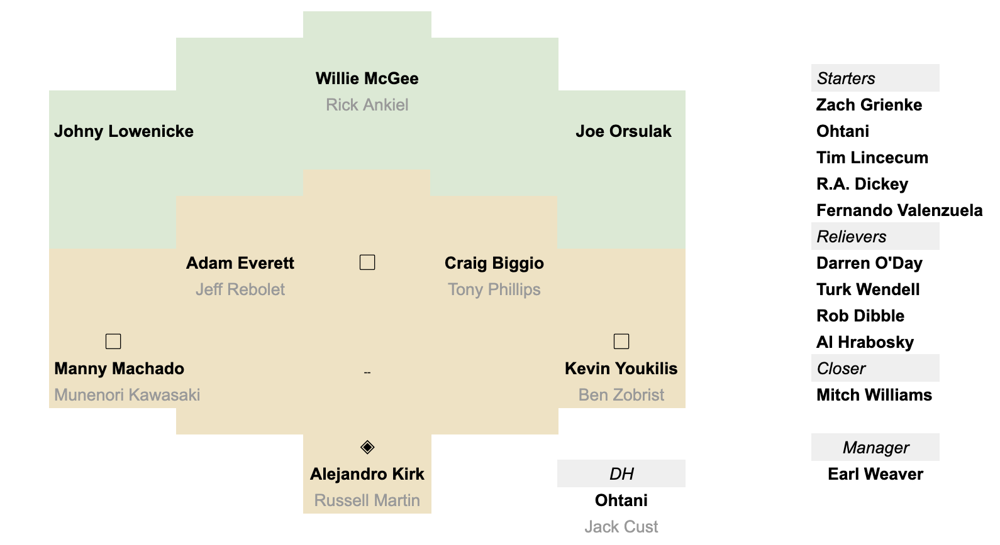

Some players dominate through sheer power or raw speed, but others do it through sheer force of quirk. The All-Quirk Team (AQT) celebrates baseball players who made it, and make it, fun for me to watch the game of baseball. There are a few constraints around who I've included in this list:

- They are *my* choices and therefore the correct choices for *me* -- if you have better choices then post your own AQT
- They are players who were active during my lifetime
- I can remember seeing them play either live or on TV
- Backups should be plausible as backups
- Quirk manifests in many ways (see descriptions below for details)

I've been managing an All-Quirk Team roster for decades and at this point it doesn't change that much. However, following the AL East and watching the 2025 playoffs has motivated me to assign a new starting catcher and so now is a good time to go back over the roster and talk about it a bit.

## Manager - Earl Weaver

I grew up in Baltimore and so it should come as no surprise that my managerial choice is the fiery [Earl Weaver](https://www.baseball-reference.com/managers/weaveea99.shtml). His antics were always on the local news and so those memories are still clear in my mind. A friend and I spent countless hours playing [Earl Weaver Baseball](https://shot97retro.blogspot.com/2021/10/earl-weaver-baseball-in-depth-written.html) on his Amiga and for some reason it felt very different than every other baseball game at the time. It wasn't until later that I learned that many consider Weaver [one of the first managers to use analytical techniques](many consider Weaver one of the first managers to use analytical techniques.). His ideas around managing, tactics, and analysis were very quirky for their time, so Weaver gets my nod for the AQT skipper job.

## Catcher - Alejandro Kirk

[Alejandro Kirk](https://www.baseball-reference.com/players/k/kirkal01.shtml) has slugged, framed, and waddled his way into my heart. Kirk looks exactly like my neighbor, so he gets points right out of the gate. However, what made me decide to make him my starting AQT catcher was that time after time game broadcasts showed his height and weight rather than his stats, and time after time he rises to the occasion.

## First Base - Kevin Youkilis

For a time I was into sabremetrics and so it's only natural that [Kevin Youkilis](https://www.baseball-reference.com/players/y/youklke01.shtml) lands on this list. What makes Youk so interesting is that not only did analytics predict his greatness, he also lived up to the hype. From 2007-2010 he was knocking on the door of winning an MVP all along the way was the epitome of *Moneyball*. It doesn't hurt that his batting stance looked like one of the soccer kids in the neighborhood playing wiffleball.

## Second Base - Craig Biggio

[Craig Biggio](https://www.baseball-reference.com/players/b/biggicr01.shtml) may be one of the most underrated players in the Hall of Fame. It's hard to imagine how that can be the case, since baseball has already memorialized him in the Hall, but I think the fact that he wasn't a unanimous choice is a baseball crime. I played baseball for a very long time and was a second-baseman for a majority portion of those years. Here's the thing, Biggio was my favorite player while he was still a catcher, but when he moved to 2B he was forever in my personal pantheon. I tried to stretch my very limited baseball ability into something that resembled the way that Biggio played -- get on base, at all costs, and do it all the time.

## Third Base - Manny Machado

Of course I grew to like [Manny Machado](https://www.baseball-reference.com/players/m/machama01.shtml) during the early part of his career in Baltimore as a hot-headed star. However, it wasn't until he landed in San Diego that he landed on the AQT. There have been countless numbers of hot-headed young players in the history of MLB, but Machado elevated his aura to "rogue cool" in San Diego. Love him or hate him, you have to admit that he's cooler than you... and this angers people even more.

## Shortstop - Adam Everett

There were numerous years during his career that if [Adam Everett](https://www.baseball-reference.com/players/e/everead01.shtml) had only ever played SS, he would still have been more valuable than 75% of his peers. Everett's glove was so transcendent that he completely flummoxed the so-called baseball cognoscenti at the time. It's a crime against baseball that he never won a fielding award.

## Left Field - Johny Lowenicke

If not for [Robin Yount](https://www.baseball-reference.com/players/y/yountro01.shtml)'s amazing 1982 season, the AL MVP award at the time may have gone to a Voltron named Johny Lowenicke... well, it should have any way. Lowenicke took form by combining two players [John Lowenstein](https://www.baseball-reference.com/players/l/lowenjo01.shtml) (who looked like Weird Al) and [Gary Roenicke](https://www.baseball-reference.com/players/r/roeniga01.shtml) (who looked like Les Claypool) to achieve their final, perfected form. It was correct that Yount won the AL MVP in 1982 with his 9.8 WAR, but right on his heels was Lowenicke at 8.7 WAR. It's amazing what you can achieve if you combine the skills of one guy who can't hit RHP with another guy who can't hit LHP. It was pure alchemy!

## Center Field - Willie McGee

You'd be hard-pressed to find a batting style uglier than [Willie McGee](https://www.baseball-reference.com/players/m/mcgeewi01.shtml)'s. He was all knees and elbows and would weirdly twitch while he was waiting for the ball. His swing could be described as literally throwing the bat at the ball. He had a wiffle ball playing soccer-player's swing if said soccer player was trying to switch hit for giggles. Amazingly he rode this abomination to 4 All-Star appearances and an MVP award in 1985. Rock-on my quirky center-fielder!

## Right Field - Joe Orsulak

Let's talk about another player who couldn't possibly have ever been able to hit a baseball, but someone had a 14-year career. [Joe Orsulak](https://www.baseball-reference.com/players/o/orsuljo01.shtml) was a baseball player who had no power, was slow, and looked like a landscaper. One thing that he did really well was to trick people into thinking that he sucked at baseball so that they would try to stretch extra-bases on his and then ultimately get thrown out on the bases by Joe.

## Designated Hitters - Shohei Ohtani

I'll be honest... [Shohei Ohtani](https://www.baseball-reference.com/players/o/ohtansh01.shtml) made the AQT the moment that he stepped onto a MLB field. Ohtani-sama is the first, but hopefully not the last, two-way player in 1,000,000 years and a joy to watch. I feel like watching Ohtani play these days is like watching Michael Jordan in his prime... you just know that you're seeing someone at their peak, playing at an inconceivable level.

## Bench

Backing up at catcher is [Russell Martin](https://www.baseball-reference.com/players/m/martiru01.shtml) who seems to have invented pitch-framing. Before Martin hit the scene, catchers didn't even use mitts. Instead they would let the ball hit their chest pad and then pick the ball up afterwards. As an added bonus, at his peak Martin was on the MVP bubble and could swing a stick for a time. [Ben Zobrist](https://www.baseball-reference.com/players/z/zobribe01.shtml) was robbed of an MVP award in 2009, all while getting time at every position but catcher or pitcher. Indeed, Zobrist may be the best utility player to ever play the game. There were few player whose swagger game was stronger than [Tony Phillips](https://www.baseball-reference.com/players/p/phillto02.shtml)' swagger game. As a nice bonus, Phillips was an on-base machine and always found a way to score a run. [Munenori Kawasaki](https://www.baseball-reference.com/players/k/kawasmu01.shtml) was more known for his interviews than his baseball skills, but wow did he have some epic interviews. When [Jeff Reboulet](https://www.baseball-reference.com/players/r/rebouje01.shtml) played, he did almost everything at the level of a replacement player, except for one thing... hitting against Randy Johnson. If Reboulet had faced Johnson for every one of his MLB at-bats then he'd be in the conversation for the best of all time. Unfortunately, Reboulet had to bat against other pitchers also. That said, he was a serviceable fielder almost everywhere on the field. When [Rick Ankiel](https://www.baseball-reference.com/players/a/ankieri01.shtml) said that he was going back to the minor leagues to switch his career from pitcher to outfielder, the world laughed. Less than 3-years later we were all humbled when he returned to the majors as an outfielder and hung on for a second baseball careers. Most people have zero MLB careers, and even the best players only have one, so what Ankiel did was astonishing. The final bench player is the purest 3-outcome player that I can remember, [Jack Cust](https://www.baseball-reference.com/players/c/custja01.shtml). If Cust was at bat one of three things were guaranteed to occur, in descending order: strikeout, walk, home-run. There were no other outcomes ever. On the AQT, Cust is a wonderful fit, but he'll never be a pinch-runner while I'm in charge. Finally, my AQT bullpen catch is none other than [Jamie Quirk](https://www.baseball-reference.com/players/q/quirkja01.shtml) -- do I even need to explain why?

## Starting Rotation

[Zack Greinke](https://www.baseball-reference.com/players/g/greinza01.shtml) was a perennial MQP and naturally fits at the top of the rotation of my AQT. Greinke will likely be voted into the Hall of Fame and his unique personality will go down in legend. I don't know if [Shohei Ohtani](https://www.baseball-reference.com/players/o/ohtansh01.shtml) will be able to pitch and bat forever, but he's forever immortalized as the only two-way player in the history of the AQT! I had the good fortune to see [Fernando Valenzuela](https://www.baseball-reference.com/players/v/valenfe01.shtml) pitch in Baltimore during his 1-year with the Orioles. However, he was on the down-slope of his career at that point, and most of the amazing things were behind him. That said, it seem essential that the AQT have a screwball pitcher right? By that same logic, it seems that a knuckleballer is also essential to the AQT. In reality, if I followed the definition of quirk to its logical limit then *every* pitcher would be a knuckleballer, but where's the fun in that?! So to choose one I have to go with the inimitable [R.A. Dickey](https://www.baseball-reference.com/players/d/dicker.01.shtml), whose knuckleball was wholly unique for its speed. Finally, to round out the starting rotation, it's only fitting that I choose someone whose nickname was "The Freak", aka [Tim Lincecum](https://www.baseball-reference.com/players/l/linceti01.shtml). He was incredibly fun to watch in his prime and at times he seemed to do impossible things. It's sad that his career was cut short, but he made quite the impression when he played.

## Relievers

In an attempt to stay in touch with the important aspects of quirk, I feel that a submarine pitcher is absolutely essential to the culture of the AQT. There are so many to choose from that it's hard to go wrong, so I'll instead choose my favorite submariner of all time, [Darren O'Day](https://www.baseball-reference.com/players/o/odayda01.shtml). He made the all-star team only once while with the Orioles, but he was incredibly reliable for 6+ seasons with the team. In a similar mold as Greinke, [Turk Wendell](https://www.baseball-reference.com/players/w/wendetu01.shtml) chewed black
licorice, brushed his teeth between innings, hopped over foul lines and fully embraced every superstition possible, but was a functional reliever for years too. The fireballer [Rob Dibble](https://www.baseball-reference.com/players/d/dibblro01.shtml) was an absolute madman when he played, and was one of the few guys to hit triple-digit speeds during a time when doing so wasn't ubiquitous. The amazing [Al Hrabosky](https://www.baseball-reference.com/players/h/hraboal01.shtml) sits at the edge of my working baseball history memory, but I'm going to run with "The Mad Hungarian." His antics and fiery attitude are epic and he was a truly unique personality in the history of the game. Finally, to round out my bullpen I'd like [Mitch "Wild Thing" Williams](https://www.baseball-reference.com/players/w/willimi02.shtml) whose windup was pure chaos. On every single pitch he would put everything that he had into it and even fall over at the end. He was a bright burning star of a player at his peak.

And there we have it, the All-Quirk Team 2025 update.
