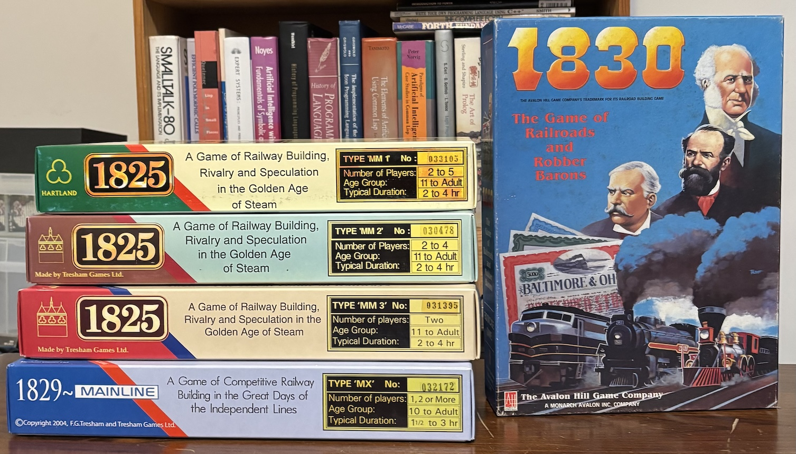
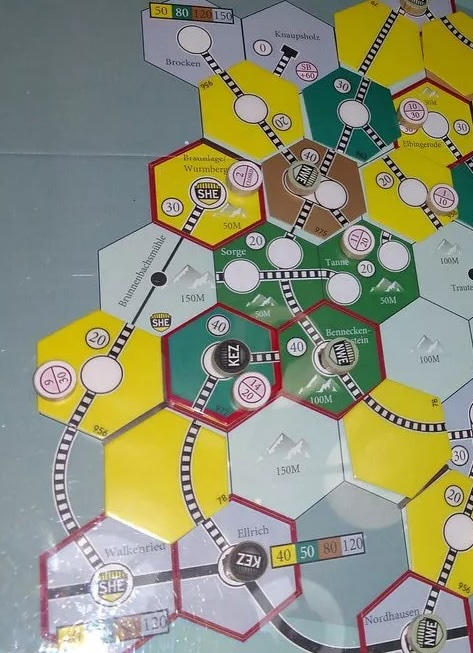
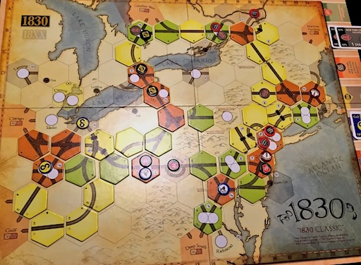
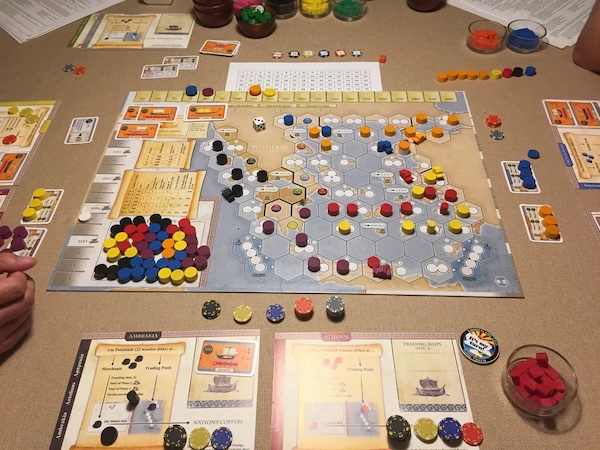

Prior to COVID I had a fairly regular game group that focused almost entirely on playing economic train games known as "18XX".[^cubes] There is no single game called "18XX" and the term is used to describe a family of games that generally involve participating in and manipulating a stock market, managing a portfolio, building train networks, and guiding the operations of train companies. The 18XX family began in 1974 with [Francis Tresham](https://en.wikipedia.org/wiki/Francis_Tresham_(game_designer))’s [1829](https://boardgamegeek.com/boardgame/1823/1829), a pioneering design that was followed up 12-years later by the cutthroat [1830: The Game of Railroads and Robber Barons](https://boardgamegeek.com/boardgame/421/1830-railways-and-robber-barons).[^pc1830] In the decades since, dozens of designers have created hundreds of variants and expansions and even today there are still publishers releasing new 18XX games. Why has this niche family spawned so many titles over nearly five decades? The reason is that the underlying 18XX framework is a modular, interlocking system that leaves vast room for innovation in its levers, constraints, and feedback loops. In this post I'll talk about the 18XX subsystems and briefly how they interact, with a couple of brief sidelines into specifics, to try and paint a picture about the robustness of the common mechanics.

[^cubes]: We also often played cube-rails games, which is a topic for another day.

[^pc1830]: 1830 also had an [MS-DOS version](https://en.wikipedia.org/wiki/1830:_Railroads_%26_Robber_Barons) that had surprisingly strong computer players.

## Each Game is Three Sub-games

Every 18XX balances to varying degrees three sub-games:

1. *A stock market game* - buy, sell, and manipulate shares
2. *A network game*      - lay track, connect cities, run trains
3. *A technology race*   - buy, upgrade, and obsolete trains (and other game-specific techs)

These are three loosely coupled modules with tight feedback loops. Output from one is input to the others and back again.

The progression of 18XX games is clocked by alternating phases:

- *Operating Rounds* (OR) - when players, on behalf of their companies, build or upgrade track or stations, buy or sell trains, and run trains on the tracks for (hopefully) profit, and choose to pay or withhold dividends to stockholders
- *Stock Rounds* (SR) - when players buy or sell shares in companies, and float new companies

While the general flavor of most 18XX ORs and SRs are the same, there's [a lot of room for nuance](http://www.fwtwr.com/18xx/rules_difference_list/contents.htm) that each game in the family utilizes in unique ways. For example, there are often limits on dumping stock, but 1830 eschews limits allowing the president of a train company to empty its coffers, sell its trains, and then dump stock, assigning one of the minority shareholders as the new president and on the hook for covering all mandatory costs.

## Sub-games as Feedback Loops

One of the genre’s most interesting properties is how the sub-games feed each other.

- *Network --> Stock*: Build a great route, run a profitable train, your company’s share price rises
- *Stock --> Technology*: Force a rival to buy an expensive train early, their treasury empties, delaying track upgrades and stations
- *Technology --> Network*: Permanent trains enable long routes, making certain tiles, stations, and connections more valuable

In any game, players can interact with and intervene in this feedback loop to influence the thrust of the game. Often these interventions are intractable in their long-term effects, which adds uncertainty into a system that is usually open to complete observation.

## High Information, Butterfly Effects

In general, the information available to 18XX players within a game is open for all to see and reason about. Players can see the map, the stock prices, the train roster, (usually) other players' holdings, and random effects are very rare once games have started. For the most part, 18XX games are calculable given the information available to all of the players.

In practice however, small nudges in one element of an 18XX can cause rippling, "[butterfly effects](https://en.wikipedia.org/wiki/Butterfly_effect)." A few examples are:

- A missing tile in the manifest, or a blocking station token can force costly detours or shut out players from map regions 
- A price token pinned to a ledge on the stock chart can blunt the rise or fall of that stock's value
- Careless par price selection can ripple effects throughout the course of an entire game
- The priority deal that (defining who gets first action in a SR) can motivate company gutting and stock-dumping
- Train "rusting" usually triggers when certain newer model comes into play, wiping old models out of the game, flipping a company from one that reaps healthy revenue to an insolvent one

The examples above are only a few examples of the kinds of knobs that 18XX designers play with, making 18XX games fun laboratories for studying deterministic chaos. While the rules of any given game are fixed, emergent behavior and butterfly effects beget depth of possibility and play.

## Four Strategic Archetypes

Across its many variants, 18XX offers [four broad games](https://kanga.nu/~claw/blog/posts/2013/08/03/game-observances/structural-analysis/) inside the game:[^clearclaw]

1. *Run Good Companies* - shepherd one or two firms from humble beginnings to efficient networks, permanent trains, and stable dividends
2. *Find the Free Money* - dividends from others’ companies, government subsidies, or other windfalls that require no operational risk
3. *Put Things Together* - mergers, synergies, the compounding effect of route-building plus stock play
4. *Timing / Brinkmanship Games* - buy/sell at the right instant, lay a critical tile before a train rush, pull your stock price off of a ledge before manipulating its price, upgrade trains just ahead of a rusting event or to trigger one

The best 18XX tend to mix and match all of the archetypes to varying degrees. These archetypes are further enhanced with mechanics that add tactical depth to the strategic mix like train availability/obsolescence tempo, high or low income, track tile mix, importance of dividends, full vs. incremental capitalization schemes, stock shenanigans of various flavors, types of liabilities, and portfolio composition to name only a few.

[^clearclaw]: While my post is designed to give a quick overview, if you're interested in diving deeply into the nuances of 18XX then [J.C. Lawrence's blog is a masterclass](https://kanga.nu/~claw/blog/).

## Finance vs. Engineering

The innumerable ways to mix the strategic archetypes with tactical considerations provide fertile ground for vastly different game experiences, but still 18XX games tend toward two broad categorizations: finance games or engineering games. Finance games tend to be driven by market participation and manipulation, while engineering games tend to reward building good companies and train networks. Finance games tend to view company control as a lever for gaining wealth, while engineering games view control as an opportunity for building something lasting. This distillation suffers from over-simplification, but the distinction becomes apparent through experience. Some players prefer finance games over engineering games[^engme], but both styles offer immense capacity for strategic depth. Of course, the best games offer a mix of the two and designers turn the dial between speculative arbitrage and infrastructure optimization to find the right mix.

Sticking with the original designs from Francis Tresham, 1830 is absolutely a finance game while 1829 and the 1825 series are more in the engineering camp.

[^engme]: For my money I tend to lean towards engineering games.

## The Appeal of 18XX as a Game System

For over 50 years game designers have been drawn to the 18XX family. As a game design dabbler (at best) myself, I can speak to the attributes that appeal to me. 

### Interlocking state machines

ORs and SRs advance the game like clock ticks, but player actions affect shared state along multiple dimensions. Designing a game that offers butterfly effects while remaining a compelling experience is exceedingly difficult without careful consideration and a lot of testing.[^doubt]

[^doubt]: Talking to great 18XX players is a humbling experience for a dabbler like myself. Some of the best can read a rule-set and instantly see the implications of the sub-game interactions whereas I need to play some number of times before the same realization clicks... if at all.

### Constraint-driven design

While 18XX games are considered some of the most complicated tabletop games in general, the set of core game mechanics is small compared to other games typically considered complex (e.g. wargames). Finding something new and compelling within a constrained set of mechanisms motivates creativity.

### Emergent complexity

Deterministic rules somehow yield unpredictable play, making the space of game possibilities exponential on the interactions in the rules. But, the more you play, the more clearly you see the little decision points where the entire game might proceed differently. 18XX rewards deep familiarity and has unlimited potential for lifelong exploration.

### A Deeply Social Game

The same rules support an infinite variety of play styles, which can shift from game to game and as a playgroup becomes more versed in any given game. 18XX games are notoriously long, ranging from 4-12+ hours in length. A lot can happen in 12 hours, so the game should motivate a group of players to want to spend so much time together.

## Where to Find 18XX Games

While 18XX remains a niche sub-genre of tabletop gaming, a few publishers have kept the family alive and evolving. Keep in mind that historically 18XX games were handmade and notoriously expensive and difficult to find, with long production cycles. However, in recent years a couple of companies have produced titles that have injected copies into the tabletop game market at lower price points and readily available.

- [All-Aboard Games](https://all-aboardgames.com/) has helped reinvigorated the 18XX market by injecting new titles into the space and making long out-of-print classics available again
- [GMT Games](https://www.gmtgames.com/) is a relatively large company that offers a solid suite of 18XX games
- [Golden Spike Games](https://goldenspikegames.com/) still follows the handmade production model on an extended time-frame, but not like the years-long duration of now defunct publishers
- [Grand Trunk Games](https://www.grandtrunkgames.com/) offers the Shikoku 1889 game that is a spiritual successor to the classic 1830
- [Lonny Games](https://www.lonnygames.com/) is a European 18XX designer and publisher who makes some of the best train games available today
- [Lookout Games](https://www.lookout-spiele.de/en/games.php) publishes some of the most well-known tabletop games, and also offers a good number of 18XX games online and in local game stores
- [Marflow games](https://18xx-marflow-games.de/) is another European designer and publisher who creates quirky (in a good way) 18XX games
- [Winsome Games](https://groups.io/g/WinsomeGames/topics) is the home of John Bohrer and friends' boutique train game designs, with a smattering of 18XX designs in the stable. These are *very* short-run productions and hard to get

Finally, the [18xx.games](https://18xx.games/) site provides a bunch of titles for online live and asynchronous play modes. I haven't yet played any games there, but many 18XX players love the site.

It's worth noting that not all 18XX games are about trains, but they all display 18XX-ness as described in this post to the degree that makes them 18XX games. For example, the game [Poseidon](https://boardgamegeek.com/boardgame/76417/poseidon) is an 18XX game where nations replace companies ships replace trains, and trade routes replace tracks.

Hopefully, I've told you enough to motivate you to look deeper at this lovely tabletop gaming niche.[^favs] I've found that people who appreciate systems-level thinking are drawn to 18XX games, but there are deeply social aspects that can draw others as well. I won't lie however, these are not games for everyone. You must be prepared to spend a whole day at the gaming table, especially in the first few matches of any given 18XX game. Also, some of the games are highly contentious which is a turn-off for some. But if you're looking for a set of games that can entertain you for the rest of your life then you can't do much better than 18XX.

:F

[^favs]: A few of my favorites that are readily available include: [1830: Railroads and Robber Barons](https://www.lookout-spiele.de/en/games/1830re.html), [1846: The Race to the Midwest](https://www.gmtgames.com/p-847-1846-the-race-to-the-midwest-1846-1935-2nd-printing.aspx), [1849: The Game of Sicilian Railways](https://all-aboardgames.com/products/1849), and [Harzbahn 1873](https://all-aboardgames.com/products/international-harzbahn-1873).
