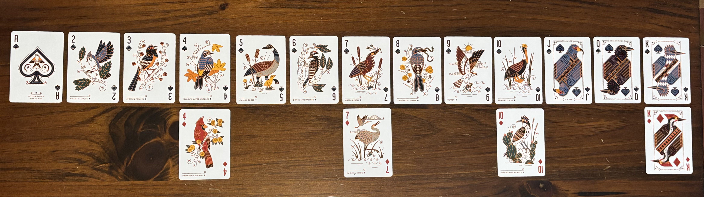

# Introduction

While reading John Conway's The Book of Numbers (1996) years ago I was impressed by a truncated deck of playing cards that he called "Sweet Seventeen" used to illustrate mathematical principles. "Sweet Seventeen" is a subset of the standard 52-card, French-suited pack that takes only one suit of 13 cards and mixes in four numbered wildcards. In Conway's pack, the wildcards appear anywhere in a hand of cards, but must always be ordered by their number value. After playing around with this a little bit I decided that while mathematically interesting, the "Sweet Seventeen" pack was not as interesting to play with. To try an remedy this, I fiddled with some wildcard schemes and landed on something that felt good in practice. The pack that I finally landed on is called "Bird-Poker" and is described herein. Bird-Poker uses the same 13 cards in a single suit, but takes a different approach to wildcards and Aces.

## Aces and Wildcards

The first difference from "Sweet Seventeen" is that Bird-Poker Aces rank either as the lowest or highest rank depending on the needs of the hand. A more significant change is that while there are also four wildcards, they are comprised of the ranks  4, 7, 10, and King (W4, W7, W10, and WK). The difference from Conway's wildcards is that each Bird-Poker wild can only substitute for cards of its own rank or lower. For example, W4 can stand in for 4, 3, 2, or Ace-low, while WK can stand in for anything up to King (but never Ace-high). When combined with the base suit, you get a 17-card pack. This compact size is ideal for head-to-head Poker (especially 3-card) or small-table games, but the interactions of the flexible Aces and "windowed" wildcards adds some nuance to the deck. The effect is that straights, flush-like runs, and sets are flexible, but only in patches. You might find yourself drawing to a straight that looks open-ended, only to realize its completion hinges on a single wild still lurking in the talon. I can envision games using a single standard pack of cards to build one or two Bird-Poker packs shared or each used exclusively by both players in a 2-player game. The personal-deck scenario motivates a concept I like to call "tightness" that describes the degree to which a run or set is filled by ranked base cards or wilds. Simply put, the tightest hand would use no wildcards for its combination, besting a loose hand that needs wildcards to construct the same combo.

## Bird-Poker Hands

Bird-Poker respects the familiar hierarchy of Poker hands, but with twists shaped by the wild rules. A few highlights:

-   **Five of a Kind**: Possible, but exceedingly rare. Only the low ranks (Ace-low through 4) allow this, since all four wilds must collapse into the same value.
-   **Pairs, Trips, and Quads**: All impossible in the base suit, but wilds allows extension. For instance, W4 can help form four-of-a-kind in 4s, 3s, 2s, or low-Aces.
-   **Straights**: More dynamic than in standard Poker. Wilds like W7 or W10 open mid-rank straights, but each still carries a "tightness" cost. Bird-Poker supports exactly ten natural straights of five cards.
-   **Full Houses**: Appear in unexpected ways, but still require significant wildcard support.
-   **High Ace Straights**: W10 and WK extend play toward the top of the base suit, but high-Ace is always untouchable.

The result is a legal hand space that's smaller than 52-card Poker but expressive in interesting ways.

## Why Seventeen Matters

As Conway discovered, seventeen cards turns out to be the sweet spot. With fewer wilds, hands collapse into dull short-pack Poker. With more, the game becomes chaotic, straights trivial to complete, and face cards lose their drama, but with windowed wildcards they still retain their stature: a run up to King is still hard-earned, even with W10 and WK lending support. At seventeen, you get just enough wild pressure to open new possibilities, while still keeping tension around rare but powerful combinations and still supporting bluffing. Instead of drowning players in calculations, the design aims for a natural feel: straights are more common, but not guaranteed; pairs remain steady anchors; and full houses or higher become special events that feel worth celebrating.

## Variants Along the Way

While playing around with Bird-Poker I hit some way-points in how wildcards work, including:

-   **Random wild draws**: shuffle the wild suit separately, and add a few random wilds into the pack each game. I didn't feel that it added anything better than fixed wild ranks.
-   **Progressive wilds**: players can win wilds into their personal packs, adding them in for later rounds. This could be a feature of a particular game rather than then deck itself.
-   **Rotating wilds**: different wilds enter play each hand, shifting the "terrain" of what is possible. This needs more exploration.

Eventually the fixed wildcards won out, but there could be more situations to explore.

Bird-Poker was a fun little toy to play with and if you have a pack of cards laying around it's simple to assemble and play with yourself. I've toyed around with games using the deck and it's been a surprising vein for inspiration. Enjoy.

:F
