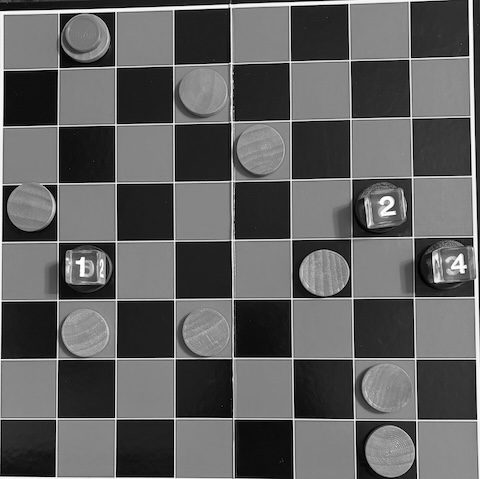
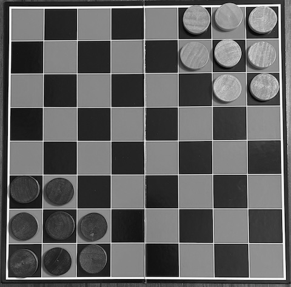
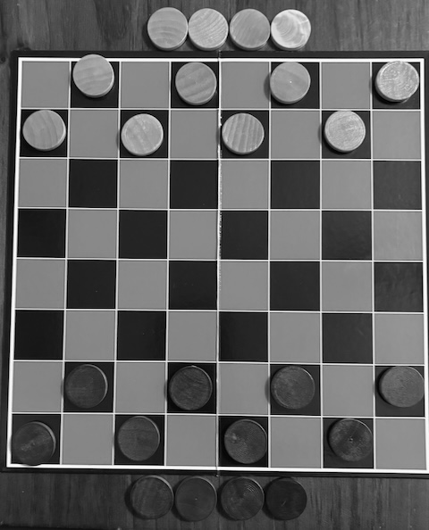
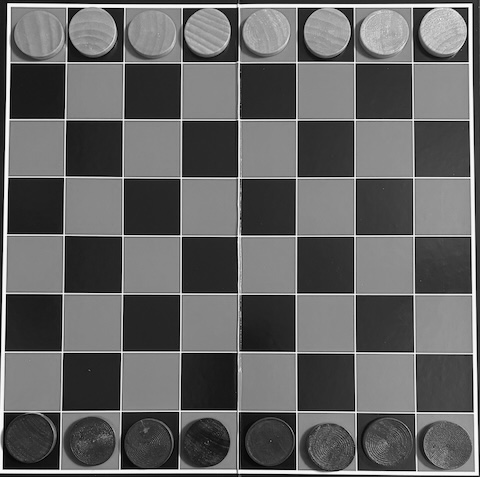
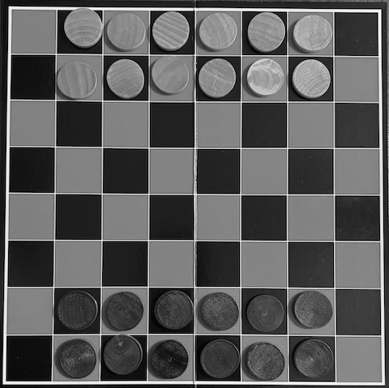
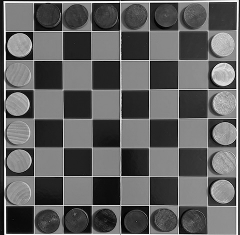
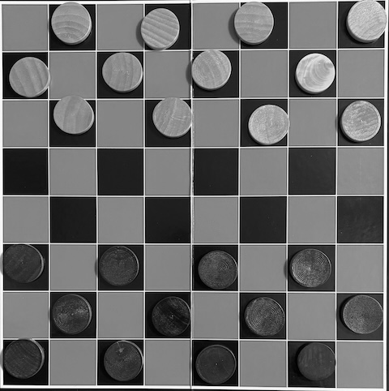
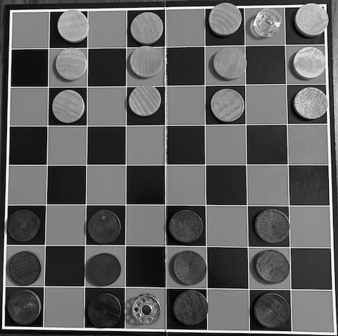

The gift-giving holidays are quickly approaching and with them comes the inevitable stress around what and how much to give. If you happen to have a friend or loved on who enjoys activities that stimulate the intellect then I have good news for you. For only a couple of dollars and a printout of this post, you can give your friend a "Checkers Arcade" set that could occupy them for the rest of their lives. All that Checkers Arcade requires is a standard American Checkers set having an 8×8 board and 12 discs per side in two colors. If you don't already have a Checkers set laying around then you can usually find one for a dollar or two at your local dollar store or thrift shop. With this simple kit, you can play a surprising number of interesting games that offer everything from light fun to dense strategic puzzles. Below I'll provide some details and rules for some of my favorites. But first, let me take a quick moment to talk about how I've categorized the games in this post.

First, the word "Decision Horizon" reflects the scope of player decisions and the kinds of moves that players need to consider in a typical game. The values are:

- Immediate: Short, immediate-action horizon.
- Local: Mid-range action horizon, often focused mostly on local positions on the board.
- Far-reaching: Long-range planning horizon with a focus on long-term goals.

While deciding which game to play can be informed by its complexity, often the true deciding factor is how much time is available to play at all. Therefore, the reference guide below is sorted by expected play time. Almost all of the games are 2-player games, but I added a couple that support 2-4 players.

| Game                                  | Players | Decision Horizon | Play Time | Short Description                                                                                             |
|---------------------------------------|---------|------------------|-----------|---------------------------------------------------------------------------------------------------------------|
| [Ricochet Roombas](#ricochet-roombas) | 2-4     | Local            | 10 min    | Be the first to find the shortest path from a specific disc to a goal disc.                                   |
| [Checkers Go-Moku](#checkers-go-moku) | 2       | Local            | 10–15 min | A quick duel to assemble a line of 5 discs to eliminate your opponent's discs.                                |
| [Halma](#halma)                       | 2       | Local            | 10-15 min | A quick jumping game where you move all of your discs into your opponent's starting zone.                     |
| [Squava](#squava)                     | 3       | Immediate        | 10-15 min | A quick 3-player game where players create a line of 4 discs to win, but lose if they ever make a line of 3.  |
| [Hobbit Checkers](#hobbit-checkers)   | 2       | Local            | 10-20 min | My own variant of Checkers where your discs can get more and more powerful.                                   |
| [Vault](#vault)                       | 2       | Local            | 10–20 min | A leaping game where your own discs become mobility ramps for multi-jump captures.                            |
| [Breakthrough](#breakthrough)         | 2       | Local            | 10-20 min | "Break through" to your opponent’s home row to win.                                                           |
| [Lines of Action](#lines-of-action)   | 2       | Far-reaching     | 15+ min   | A connectivity race where discs move according to how many occupy a line, driving rapid, tactical formations. |
| [Bashni](#bashni)                     | 2       | Far-reaching     | 20+ min   | A stacking-based capture game where towers change hands for dramatic reversals of fortune.                    |
| [Cannon](#cannon)                     | 2       | Far-reaching     | 20+ min   | A formation-based game where mobile artillery try to capture the opponent’s town.                             |

## Definitions

In the rules the following terms are used:

Discs
: The player pieces. There should be 24 of them in two different colors.

Square
: The squares on the board. There should be 64 of them. They usually alternate colors.

Orthogonal square
: A square touching the left, right, front, or back flat-sides of another square.

Diagonal square
: A square touching any of the four corners of another square.

Adjacent square
: A square that is orthogonal or diagonal to another square.

Column
: An up-to-down arrangement of squares. There are eight columns.

Row
: A left-to-right arrangement of squares. There are eight rows.

Home Row(s)
: The closest rows to yourself.

Token
: Some games need extra pieces. It's usually not important what they are, so I'll refer to them as "tokens."

## Ricochet Roombas

Ricochet Roombas is a personal adaption of the amazing game called [Ricochet Pyramids](https://boardgamegeek.com/boardgame/131848/ricochet-pyramids) by Russ Williams, which itself is an adaptation of [Ricochet Robots](https://boardgamegeek.com/boardgame/51/ricochet-robots), designed by [Alex Randolph](https://en.wikipedia.org/wiki/Alex_Randolph) in 1999.

Up to 4 players start the game with 9 discs of one color to serve as goals and 3 discs in the other color to use as the roombas. Using dice or bits of paper, label each of the roombas.

### How you win

You win by being the first to discover and demonstrate the shortest path from a roomba to the goal disc.

### Setting up the board

- Take the 9 goal discs and randomly distribute them onto the board. Some clustering is OK, but try to keep them spread out overall.
- Next, randomly place the roombas onto the board.
- Finally, randomly select a goal disc and one of the roombas, and place a marker on the goal.

### Finding, declaring, and demonstrating the shortest path

The basic principle of the game is to find a path from the chosen roomba, to exactly on top of the goal disc. When a player thinks they've found the shortest path, they may speak the number of moves required to land on the goal. That player then moves any of the roombas the same number of times that they declared, landing on the goal at the end. Any roomba movement counts as one move, not just the chosen one. If the player's declaration was correct and none of the other players can find a shorter path, then they win the round. Otherwise, one of the other players may declare a shorter path and demonstrate it from the same starting position.

### How roombas move

A roomba moves orthogonally in any direction and only stops when it runs into one of the following:

 - Another roomba.
 - The edge of the board.
 - Any of the non-goal discs.

The goal disc is special in that the roombas always pass through it without stopping if there's nothing behind it. Therefore, to land on a goal, the roomba must be stopped by one of the other blocking objects.

### Things to keep in mind while playing

- Labeling the roombas is important because you can leave the labels in place before you demonstrate the path so that you can use the labels to setup the original position again if needed.

## Checkers Go-Moku

[Checkers Go-Moku](https://boardgamegeek.com/boardgame/87467/checkers-gomoku) is a good way to start exercising your gray matter when you first break out your set, and as a bonus, it's a good quick game for two any time.

The game is played in two phases: a placement phase followed by a movement phase. 

### How you win

You win by capturing all but the last four of your opponent's discs.

### Capture

If a player makes a line of five of their own discs in a straight line across five adjacent squares, then they may remove any one of their opponent's discs.

### Placement Phase

Taking turns, each player places one of their discs onto any empty square until all of their discs are placed.

### Movement Phase

Taking turns, each player moves one of their discs to any adjacent empty square.

### Things to keep in mind while playing

- You can capture discs during the placement phase too.

## Halma

[Halma](https://boardgamegeek.com/boardgame/38950/halma) was designed in 1883 or 1884 by [George Howard Monks](https://en.wikipedia.org/wiki/George_Howard_Monks) for a 16x16 board, but the game can be adapted for smaller boards. 

Players start the game with 8 discs aligned in a 3x3 square with the top-left disc removed, in the right corner of their side of the board. This is known as the starting zone.

### How you win

The first player who moves all of their discs to completely fill the opponent's starting zone wins the game.

### Gameplay

Players take turns moving one of their discs either by moving it to any adjacent empty space or jumping over any adjacent disc and landing immediately behind it in the direction of the jump. Jumps may be chained together as many times as possible, in any direction.

Once a pieces lands in any of your opponent's starting zone squares, then it can never exit that zone.

### Things to keep in mind while playing

- Jumping backward may seem counter-intuitive, but sometimes it the best way to set up longer future jump chains or to block an opponent's discs.

## Squava (for three players)

[Squava](https://boardgamegeek.com/boardgame/112745/squava) is a 2-player game designed by [Néstor Romeral Andrés](https://www.nestorgames.com/) and [Cameron Browne](https://cambolbro.com/), adapted for 3-players by Craig Duncan.

This game needs more than just the discs that come with a standard American Checkers set. The good part is that for the third player, you can use anything for the additional 12 tokens like: coins, beans, dice, buttons, cookies, washers, etc.

The board starts empty and then players take turns placing one of their tokens on any empty square. If on your turn, one of your possible moves prevents a win by the next player, then you must make that move.

### How you win

You win by making a orthogonal or diagonal line of four of your tokens or the other two players are eliminated from the game.

### How you are eliminated from the game

If you ever make an orthogonal or diagonal line of three of your tokens, then you are eliminated.

### Things to keep in mind while playing

- It's possible (but rare) that players might place all of their discs without ever making a line of four.
- If you can make a triangle of your tokens where each piece has two squares between it and each of the other two tokens then you have a powerful position.
- A similar square of your tokens is even more powerful.

## Hobbit Checkers

Hobbit Checkers is a blend of Thai and Russian Checkers that I played with my kids when they were very young. These are the rules as I wrote for them way back in the day.

- You control 8 **adventurers** to start the game.
- An adventurer only 1 disc high is a **hobbit**.
- An adventurer with a stack of two or more discs is a **ranger**.
- You control all adventurers that have one of your discs at the top.
- The taller your adventurer grows, the stronger and faster it becomes!

Each player sets up their side of the board the same way:

-  Place 8 discs on the dark squares of the two home rows closest to you. The row closest to you is your **village**.
-  Keep your remaining 4 discs nearby. These are your **feathers**.

### How you win

You win if your opponent has no more moves on their turn.

### Gameplay

On your turn, you will move one of your adventurers into an empty square or leap-frog over the other player's adventurers to make your adventurers stronger.

#### Movement

- Hobbits move one diagonal empty square forward toward the other player's side.
- Rangers move empty squares diagonally forward or backward through empty squares, up to the number of discs in the stack (for example, a stack of 3 moves up to 3 squares).

#### Getting a Feather in Your Cap

- When any of your adventurers reaches a village, you may take one of your feathers and place it on top of that adventurer.
- A ranger can travel "there and back again" across the board to land on the distant villages, earning a new feather each time until all of your feathers are used up.

#### Leap-frogging

Leap-frogging is done by jumping over one of the other player's adventurers along a diagonal line and landing in the empty square right behind it.

- Hobbits can only leap-frog adventurers sitting right next to them.
- Rangers can leap-frog adventurers that are further away by moving diagonally up to their maximum number of squares and then jumping over an adventurer.

When you leap-frog over an adventurer, you take its top disc (or the whole disc if it was a hobbit) and place it on the bottom of your adventurer. You can even get feathers in your cap while leap-frogging if you land in villages along the way!

You must leap-frog if possible. If you can continue leap-frogging after landing with the same adventurer, then you must keep jumping. You can choose the order, but you cannot jump the same adventurer more than once in the same turn.

### Things to keep in mind while playing

- If your leap-frog removes the other player's top disc and the disc underneath is one of yours, then the adventurer becomes yours to control!
- Even if you use up all of your feathers, it still might be a good idea to go into a village to keep the other player's adventures from getting close.

## Vault

[Vault](https://boardgamegeek.com/boardgame/186404/vault) is a fun jumping game designed by [Néstor Romeral Andrés](https://www.nestorgames.com/) in 2015.

Players start the game with the board between them and eight discs filling all of the squares in the their home row.

### How you win

If you start your turn with one of your discs anywhere on your opponent's home row, then you win the game.
Alternately, if your opponent is unable to make a legal move on their turn, then you win the game.

### Gameplay

Players take turns moving one of their discs, and possibly capturing one of their opponent's discs. The ways that a disc can move is either by "walking" or "vaulting."

#### Walking

You can move one of your discs to any adjacent empty square.

#### Vaulting

A vault is a kind of jumping move using two of your own discs, where one disc jumps over the other and lands exactly as far away as the distance between the two discs before the jump. Jumps can be performed in any direction orthogonally or diagonally, over any number of empty squares or squares with discs, and must land on either an empty square or a square occupied by one of your opponent's discs. If you land on an opponent's disc then it is captured and removed from the game.

### Things to keep in mind while playing

- On a Checkers board, vaults will always land on a square of the same color as the starting square. This is a nice visual marker for planning your jumps.

## Breakthrough

[Breakthrough](https://boardgamegeek.com/boardgame/3825/breakthrough) is an abstract strategy race game invented by Dan Troyka in 2000.

Players start with their twelve pieces arranged in their two home rows as two lines of 6 discs centered on the middle squares.

### How you win

You win by being the first to move one of your discs into the opponent's home row.

### Gameplay

Players take turns moving one of their discs orthogonally or diagonally forward one space. Players capture an opponent's disc by moving diagonally into an occupied square.

### Things to keep in mind while playing

- Because all movement is forward, the game is guaranteed to end in a win for at least one of the players.
- The original rules for Breakthrough called for 16 discs per player, but this variant still feels like the original game.

## Lines of Action

[Lines of Action](https://boardgamegeek.com/boardgame/3406/lines-of-action) is a pure strategy game originally by Claude Soucie in 1967 and detailed in [Sid Sackson](https://en.wikipedia.org/wiki/Sid_Sackson)'s book, *[A Gamut of Games](https://bookshop.org/p/books/a-gamut-of-games-sid-sackson/27d6735f544d0105?ean=9780486273471&next=t&aid=98208&listref=ludology)*. 

One player puts six of their discs in the middle six squares of the row closest to them and their remaining six aligned the same in the farthest opposite row. The other player places their discs similarly but on the left-most and right-most columns.

### How you win

The first players to connect all of their discs into a single connected group wins the game. Discs are considered connected if they occupy any of the adjacent squares to any other disc.

### Gameplay

Players take turns moving one of their discs either orthogonally or diagonally the number of squares equal to the number of discs in the same line as the moving piece.

- Players can jump over their own discs, but cannot land on them.
- Players cannot jump over their opponent's discs, but can land directly on one of them.
- A disc that's landed-on is captured.

### Things to keep in mind while playing

- Capturing is not always the best move because it leaves your opponent with fewer discs to connect for a win.
- Because your opponent cannot jump over your discs, you can use yours to pin theirs into place.
- It's possible, but rare, for a capture to causes both players to form a connected group at the same time. The player who made that capture wins the game.

## Bashni

[Bashni](https://boardgamegeek.com/boardgame/36550/bashni) is a pure strategy game that is a stacking variation of Russian Checkers.

Players setup the board like a regular Checkers game, were discs are placed only on the dark squares of the first 3 home rows.

### How you win

If your opponent has no valid moves on their turn, then you win.

### Gameplay

A stack is one or more discs, and its commander is the top disc that determines both ownership and movement.

Players take turns moving one of their stacks according to the type of commander that it has on top. The types of commanders are soldiers or officers.

#### Movement and promotion

- Soldiers move one diagonal empty square forward
- Officers move any number of diagonal empty squares forward or backwards

If a soldier moves into your opponent's home row then it is promoted to an officer.

#### Capturing

Capture is a special kind of movement, achieved by jumping over a stack. Soldiers capture via a short jump, landing in the diagonal empty square immediately behind the captured stack. Officers capture via a long jump where they move any number of squares, jump over the stack, and land in the diagonal square immediately behind the captured stack.

When jumping, the capturing stack removes the commander at the top of the jumped stack and places it beneath it in the landing square. 

If a capture is possible on your turn then you must capture. Captures can be chained and while a capture is compulsory, you can pick your preferred capture sequence if there are multiple choices available. You can promote soldiers to officers in the middle of a capture chain if possible. Finally, you may jump over the same stack in the same capture chain.

### Things to keep in mind while playing

- A stack will never have alternating colored discs.

## Cannon

[Cannon](https://boardgamegeek.com/boardgame/8553/cannon) is a strategic 2-player game designed by David E. Whitcher in 2003.

Players start with 4 columns of 3 discs on every other columns, starting with the left-most. Then players may place a token of their choice onto one of the squares in their home row, except for the right-most square. This token is called the town, and it may never move during the game.

### How you win

If you capture the opponent's town with a soldier or shoot it with a cannon, then you win the game.

### Gameplay

Players take turns either moving one of their soldiers or cannons, or firing a cannon.

- Soldiers are any single piece
- Cannons are composed of 3 adjacent friendly soldiers in a row either orthogonally or diagonally.

#### Movement

- A soldier may move forward to any adjacent square either in a sideways or forward direction.
- A soldier may retreat in a backwards direction exactly two squares away either backwards or along a diagonal.
  * A soldier may only retreat if their is an opponent piece adjacent to it.
  * A soldier may not retreat through squares with pieces in them.
- Cannons may move in forward or backwards directions by moving its whole row one square in the direction of movement.

#### Firing a cannon

Cannons fire a projectile along either of its two directions either 2 or 3 squares away. A cannon cannot fire in a direction in which the square directly in front of the cannon is occupied.

#### Capturing

- Soldiers capture an opponent piece when they move into an occupied square in a forward or sideways direction.
- Cannons capture if their projectile lands in a square occupied by an opponent piece.

### Things to keep in mind while playing

- Individual soldiers may be part of multiple cannons pointing in different directions.
- You can unblock a cannon by using the soldier at its front to capture the blocking disc, but doing so breaks up that cannon formation.

## Checkers Arcade expansions!

That's a good set of games to get you started. There are many more games designed with the simple Checkers board in mind, and some of the best that I'm familiar with are: [Dipole](https://boardgamegeek.com/boardgame/29491/dipole), [Byte](https://boardgamegeek.com/boardgame/19360/byte), [Nubia](https://boardgamegeek.com/boardgame/148669/nubia), and [Network](https://boardgamegeek.com/boardgame/35465/network). These games stretch the imagination far beyond standard checkers and give families a way to play something fresh without spending more than pocket change. If you have your own variants or know of other games that fit the strict 8×8-and-12-discs constraint, suggestions are welcomed.

*[I also have a print-friendly version of the Checkers Arcade manual available for download.](https://github.com/fogus/blog/blob/main/posts/games/checkers-arcade-fogus.pdf).*

:F

